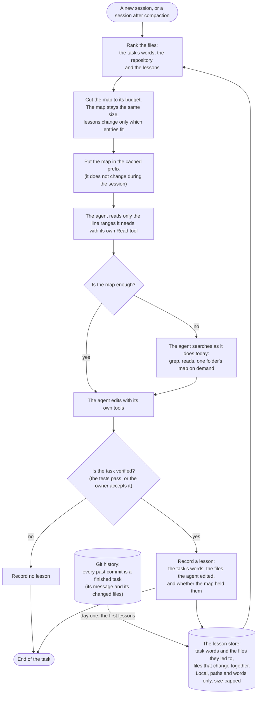
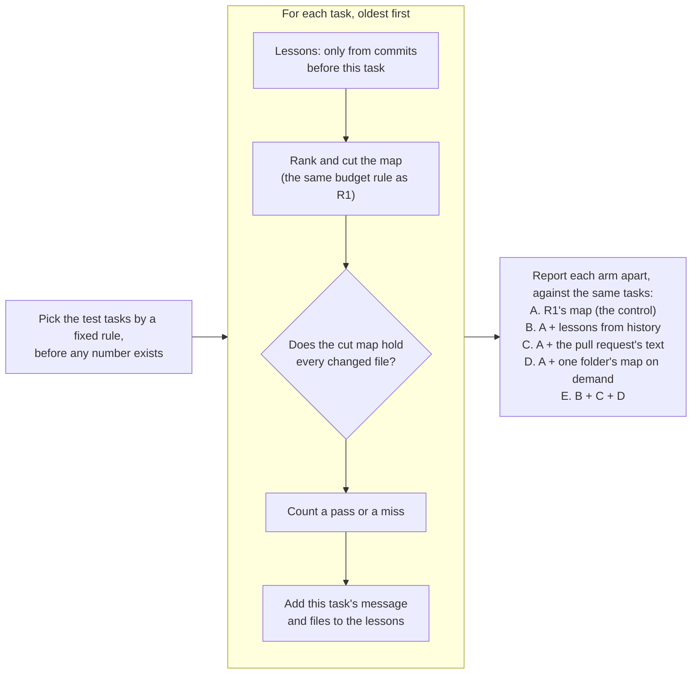

# Proposal: a map that learns from finished tasks

**Status: proposed (owner's idea, 2026-11-09; written up by the lead). Nothing here is decided.** Gate R1 missed
(31 of 85 tasks, 36.5%, against 70%; `docs/contract.md`, "The result of gate R1"). By decision 0007 the project stops
unless a new, dated decision gives a reason to continue. This proposal is input for that decision. If the owner
accepts it, a decision record (0008) and a new gate in `docs/contract.md` come next, both fixed before any number of
the new test exists.

## The idea in plain words

The map starts small and cut to its budget, as in R1. The agent uses it as far as it can. When the map is not enough,
the agent searches as it does today. When the task is done and verified, the tool records what the agent needed. The
next time a similar task comes, in this chat or in a fresh one, the map ranks those files higher, so the map alone is
more often enough.

## The loop in use

## How a free test would measure it

The test replays each repository's history in time order. For each task, the lesson store holds only the commits
before that task. No model is called, so it costs nothing, as R1 did.

Each arm shows what one idea adds, so a gain cannot hide behind another one.

## Design points

1. **Learn associations, not answers.** The same task rarely comes twice. What comes again is the same area of code:
   the same words, and files that change together. A lesson then helps a similar task, not only a repeat.
2. **The lessons change the ranking, not the map's size.** The budget stays fixed. A map that grows with each lesson
   would lose the saving; that was gate C0's failure.
3. **Git history gives the first lessons on day one.** Each past commit is a finished task. The tool learns from it
   before any agent session exists, and it reads the history only, never runs the repository's code.
4. **Learn only from verified work.** A lesson records the files the agent edited in a task whose tests passed or
   that the owner accepted. A file the agent only read is a weaker signal; the test can measure whether it helps.
5. **Prompt caching stays intact.** The map changes only at a new session or after compaction (decision 0007), so
   the cached prefix stays the same within a session.
6. **A fresh chat benefits.** The lesson store is a file on disk, so it outlives every chat.

## Risks and how the design meets them

| Risk | What could go wrong | The answer in this design |
|---|---|---|
| A wrong lesson | The agent edited a file it did not need | Learn only from verified tasks; weigh a lesson by how often it held |
| Stale lessons | A file is renamed or deleted | Drop paths that no longer exist; old lessons count less |
| One busy file wins everything | A file that changes in every commit tops every map | Count a lesson against how often the file changes at all (as BM25 discounts common words) |
| A planted instruction | A hostile file's text ends up in the store | The store holds paths and words only, never free text, and the map treats them as data |
| Privacy | The store reveals what a developer worked on | Local and git-ignored by default; sharing it with a team is the user's choice |
| A flattering test | History lessons are a best case | Report arm B apart; real use learns slower than a replay of all history, unless it starts from history, as point 3 says |

## Open decisions for the owner

1. **Continue or stop** (decision 0007). This proposal is the reason to continue, if the owner accepts it.
2. **The new test tasks.** The lead has seen R1's results for its 85 tasks, so a fair test needs tasks nobody has
   looked at: for example, new repositories picked by the corpus rule before any measurement, or commits newer than
   the pins.
3. **The threshold and the budget** of the new gate, fixed before the run. R1's were 70% at 25% of the baseline.
4. **The pull request's text (arm C)** needs GitHub's API, a network host the scripts do not use today. Some pull
   requests list their changed files; the rule for those is fixed before the run.
5. **Arm D, one folder's map on demand,** needs a rule for which folder a simulated agent asks for (for example, the
   folder of the top-ranked file). A real agent's choice is measured only in the paid pilot.

## Prior art (from memory, not verified yet)

- **Co-change mining:** Zimmermann et al., "Mining Version Histories to Guide Software Changes" (ICSE 2004, the ROSE
  tool): files that changed together in the past suggest each other.
- **Aider's repo map:** ranks files with a graph of references, weighted toward the files in the chat.
- **Agent memory files** (Claude Code's `CLAUDE.md` and its memory, Cursor's rules): free text that the agent reads
  each session. This design differs: its lessons are paths and words that change a ranking under a fixed budget, and a
  gate measures them.
- **Agentless** (Xia et al., 2024): finds the files, then the functions, then the lines, in steps.

What this design aims to do better: a fixed budget that never grows, lessons that cannot carry instructions, and a
measured gain per idea. `docs/prior-art.md` gets these rows, verified, if the owner accepts the proposal.
